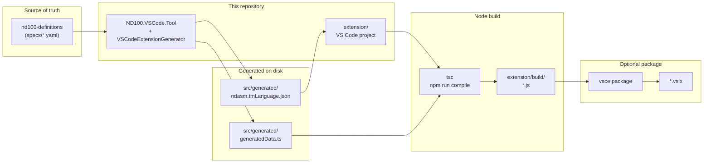
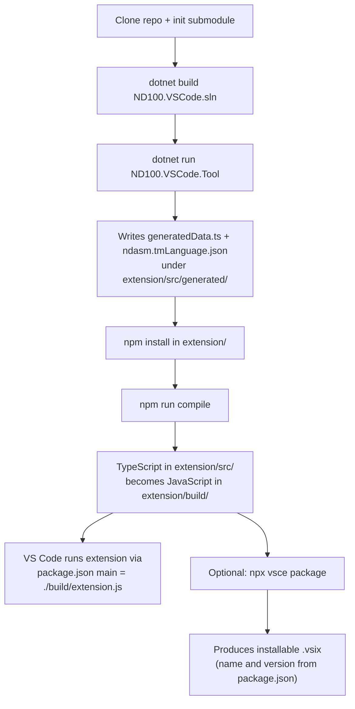

# vscode-nd100-dev

This repository is the **ND-100 VS Code extension** plus a small **.NET code generator** that turns YAML instruction/register definitions into TypeScript data and a TextMate grammar. You maintain hand-written extension code under **`extension/`**. The tool overwrites only the **generated** files. TypeScript is then compiled to JavaScript under **`extension/build/`**, which VS Code loads. Optionally you package everything into a **`.vsix`** installable plugin.

**Paths in this file** are **relative to the repository root** (the folder that contains **`ND100.VSCode.sln`**). They work for any clone on any machine.

---

## Git: what to commit vs what is ignored

**Commit** (source you care about, shared with collaborators):

| Area | What to track |
|------|----------------|
| **Solution & generator** | **`ND100.VSCode.sln`**, **`src/**/*.cs`**, **`src/**/*.csproj`**, shared project refs. |
| **Submodule pointer** | **`nd100-definitions/`** as a submodule: commit **`.gitmodules`** and the **commit SHA** Git records for **`nd100-definitions`** (run **`git submodule update`** after clone). |
| **Extension sources** | **`extension/package.json`**, **`extension/package-lock.json`**, **`extension/tsconfig.json`**, **`extension/language-configuration.json`**, **`extension/.vscodeignore`**, **`extension/README.md`**, **`extension/LICENSE`**, **`extension/.vscode/`**, all **hand-written** **`extension/src/**/*.ts`**, **`extension/src/generated/interfaces.ts`**, **`extension/src/generated/README.md`**. |
| **Codegen outputs (optional policy)** | **`extension/src/generated/generatedData.ts`** and **`extension/src/generated/ndasm.tmLanguage.json`** are **regenerated** by **`ND100.VSCode.Tool`**. Many teams **commit** them so a clone can run **`npm install && npm run compile`** without .NET. If you prefer a **TS-only** checkout, you can **omit** them from Git and always run codegen first—then add those two paths to **`.gitignore`** (and document that CI must run the tool). Pick one policy and stay consistent. |
| **Automation & docs** | **`.github/workflows/`**, **`build.bat`**, **`build.sh`**, root **`README.md`**. |

**Do not commit** (local / reproducible; listed in **`.gitignore`** at repo root):

| Pattern / folder | Why |
|------------------|-----|
| **`bin/`**, **`obj/`** | .NET build output. |
| **`.vs/`** | Visual Studio user state. |
| **`output/`** | Legacy local folder; not used by the **`extension/`** pipeline. |
| **`extension/node_modules/`** | Restored with **`npm ci`** / **`npm install`** from **`package-lock.json`**. |
| **`extension/build/`** | Produced by **`npm run compile`**. |
| **`extension/*.vsix`** | Packaged extension; build product, not source. |
| **OS junk** | e.g. **`.DS_Store`**, **`Thumbs.db`** (see **`.gitignore`**). |

The file **`extension/.gitignore`** repeats some of the same rules for tools that only look inside **`extension/`**; the **repository root** **`.gitignore`** is authoritative for this repo.

---

## Prerequisites (what must be installed)

These tools are **required** to clone, generate, and compile the extension using **`build.bat`** / **`build.sh`** (at repo root) or the manual commands below.

| Requirement | Why | Install / verify |
|-------------|-----|------------------|
| **Git** | Clones the repo and the **`nd100-definitions`** submodule. **`build.bat`** / **`build.sh`** run **`git submodule update --init`** if **`nd100-definitions/specs/cpu.yaml`** is missing. | [Git](https://git-scm.com/downloads). Check: **`git --version`**. |
| **.NET SDK 9** | Builds **`ND100.VSCode.sln`** and runs **`src/ND100.VSCode.Tool/`** (target **net9.0** in **`src/ND100.VSCode.Tool/ND100.VSCode.Tool.csproj**). | [.NET 9 SDK](https://dotnet.microsoft.com/download/dotnet/9.0). Check: **`dotnet --version`** (9.x). |
| **Node.js + npm** | Installs TypeScript and runs **`npm run compile`** under **`extension/`**. npm ships with Node. | [Node.js LTS](https://nodejs.org/). Check: **`node --version`** and **`npm --version`**. |

**Optional but typical**

| Requirement | Why |
|-------------|-----|
| **Visual Studio Code** | Open **`extension/`** and **Run Extension** (F5), or install a built **`.vsix`**. |
| **Network access** | First-time **`npm install`** / **`npm ci`** downloads packages. **`--vsix`** uses **`npx @vscode/vsce`**, which may download **`vsce`** if not cached. |

**Not required on the build machine** (unless you use them yourself)

- A global **`vsce`** install: scripts use **`npx @vscode/vsce`** when you pass **`--vsix`**.
- The ND-100 cross-compiler or emulator: those are runtime dependencies of *using* the extension’s features, not of compiling this repo.

---

## How it fits together (big picture)



---

## End-to-end flow: from specs to a compiled plugin



1. **Definitions** live in **`nd100-definitions/`** (submodule): CPU metadata, per-instruction YAML, etc.
2. **Codegen** (**`src/ND100.VSCode.Tool/`**) loads those definitions and writes **only** the two generated artifacts under **`extension/src/generated/`**.
3. **Compile** merges **all** TypeScript under **`extension/src/`** (hand-written + generated) into **`extension/build/`**.
4. **Run in VS Code**: **`extension/package.json`** points **`main`** at **`./build/extension.js`**.
5. **Ship**: from **`extension/`**, **`vsce package`** bundles the extension (including **`build/`**, grammar JSON, language config, etc.) into a **`.vsix`**.

---

## Repository folders (what they are for)

| Path | Role |
|------|------|
| **`extension/`** | **The VS Code extension workspace.** Open this folder in VS Code when developing the UI, providers, debug adapter wiring, and `package.json`. |
| **`nd100-definitions/`** | **Git submodule** with ND-100 specs. The generator reads **`nd100-definitions/specs/cpu.yaml`** and **`nd100-definitions/specs/instructions/`**. |
| **`src/ND100.VSCode.Tool/`** | **Console entrypoint**: finds repo root, loads definitions, invokes **`VSCodeExtensionGenerator`** with output path **`extension/`** (resolved as a subdirectory of the repo root). |
| **`src/NDGen.Generators.VSCode/`** | **Generator library** that emits **`generatedData.ts`** and **`ndasm.tmLanguage.json`**. |
| **`src/NDGen.Generators.Common/`** | Shared **`BaseGenerator`** / helpers referenced by the VS Code generator. |
| **`ND100.VSCode.sln`** | Solution that builds the tool + generator projects + submodule **`ND100.Definitions`**. |

Legacy **`src/NDGen.Generators.VSCode/Templates/`** is **obsolete**; the real static tree is **`extension/`**. You can delete **`Templates/`** after you no longer need it.

---

## Under `extension/`: static (manual) vs generated

### Extension root (mostly static, you edit in Git)

| File / folder | Static? | What it does |
|---------------|---------|----------------|
| **`extension/package.json`** | Yes | Extension manifest: name, version, activation, **`main`**, contributes languages/grammars/commands/debuggers. |
| **`extension/package-lock.json`** | Yes | Pinned npm dependencies for reproducible **`npm ci`**. |
| **`extension/tsconfig.json`** | Yes | TypeScript compiler options; **`outDir`** is **`build`**. |
| **`extension/language-configuration.json`** | Yes | Brackets, comments, folding for the **`ndasm`** language. |
| **`extension/.vscodeignore`** | Yes | Excludes dev files from the **`.vsix`** (e.g. **`src/`**, maps). |
| **`extension/README.md`** | Yes | User-facing extension readme (can differ from repo root readme). |
| **`extension/LICENSE`** | Yes | License text shipped with the extension. |
| **`extension/.vscode/tasks.json`** | Yes | Optional workspace tasks for building/testing. |
| **`extension/generatedData.ts.template`** | Yes | Reference only; generator uses an embedded template, not this file at runtime. |
| **`extension/test.asm`** | Yes | Sample assembly for manual testing. |

### `extension/src/` (TypeScript)

| Area | Static? | What it does |
|------|---------|----------------|
| **`extension/src/extension.ts`** | Yes | Activates the extension; registers providers, commands, debug types. |
| **`extension/src/commands.ts`**, **`buildCommands.ts`**, **`debugger.ts`**, **`settingsPanel.ts`**, **`taskProvider.ts`**, **`utilities.ts`** | Yes | Commands, build/debug integration, UI, tasks. |
| **`extension/src/providers/*.ts`** | Yes | Completion, hover, signature help, formatting, inlay hints, language registration. |
| **`extension/src/generated/interfaces.ts`** | Yes | **You maintain** TypeScript types that **`generatedData.ts`** must satisfy. |
| **`extension/src/generated/README.md`** | Yes | Explains the **`generated`** folder. |
| **`extension/src/generated/generatedData.ts`** | **No** | **Overwritten by the .NET tool.** Exports **`instructionData`** / **`registerData`** from YAML. |
| **`extension/src/generated/ndasm.tmLanguage.json`** | **No** | **Overwritten by the .NET tool.** TextMate grammar for syntax highlighting. |

### Build output (not committed)

| Path | Role |
|------|------|
| **`extension/build/`** | **`tsc` output.** Mirrors **`src/`** as **`.js`** + **`.js.map`**. VS Code loads **`build/extension.js`**. |
| **`extension/node_modules/`** | npm dependencies (local install). |

---

## One-shot build scripts

| Script | Platform |
|--------|----------|
| **`build.bat`** | Windows (cmd), run from repo root |
| **`build.sh`** | Linux / macOS / Git Bash, run from repo root |

They assume the **current directory** is the repo root (the folder containing **`ND100.VSCode.sln`**): init **`nd100-definitions`** if **`cpu.yaml`** is missing, **`dotnet build`**, **`dotnet run`** the tool, then **`npm ci`** or **`npm install`** and **`npm run compile`** under **`extension/`**.

- Optional **`.vsix`**: pass **`--vsix`** (runs **`npx @vscode/vsce package`** from **`extension/`**).

### Folders used during generation, compile, and VSIX packaging

| Step | What is **read** | What is **written** |
|------|------------------|---------------------|
| **`dotnet build ND100.VSCode.sln`** | **`src/`** (C# projects: **`ND100.VSCode.Tool`**, **`NDGen.Generators.*`**, **`NDGen.Generators.Common`**), **`nd100-definitions/src/ND100.Definitions/`** | **`bin/`** and **`obj/`** under each project (normal .NET build output; local only). |
| **`dotnet run … ND100.VSCode.Tool`** (codegen) | **`nd100-definitions/specs/`** (YAML, especially **`cpu.yaml`** and **`specs/instructions/`**), plus static files already under **`extension/`** (the tool requires **`extension/package.json`** to exist) | **`extension/src/generated/generatedData.ts`**, **`extension/src/generated/ndasm.tmLanguage.json`**, and ensures **`extension/build/`** exists (may be empty until **`npm run compile`**). |
| **`npm run compile`** (in **`extension/`**) | **`extension/src/**/*.ts`**, **`extension/tsconfig.json`** | **`extension/build/`** (compiled **`.js`** + **`.js.map`** mirroring **`src/`**). |
| **`npx @vscode/vsce package`** (in **`extension/`**) | Everything under **`extension/`** that is **not** excluded by **`extension/.vscodeignore`** (typically includes **`package.json`**, **`build/`**, **`language-configuration.json`**, grammar **`extension/src/generated/ndasm.tmLanguage.json`**, and a small subset of **`node_modules/`** per **`.vscodeignore`**) | **`extension/*.vsix`** next to **`package.json`**. Filename is **`<name>-<version>.vsix`** where **`name`** and **`version`** come from **`extension/package.json`** (same rules as **`vsce`**). |

**Not used** for the current extension pipeline: there is no **`output/`** directory anymore; the extension project is entirely under **`extension/`**.

**Submodule:** **`nd100-definitions/`** must be present (clone with submodules) so codegen can read specs.

Examples (from repo root):

```powershell
.\build.bat
.\build.bat --vsix
```

```bash
chmod +x build.sh   # once on Unix, if needed
./build.sh
./build.sh --vsix
```

---

## Commands (manual, same as scripts)

**Prerequisite:** submodule present.

```bash
cd <repo-root>    # directory containing ND100.VSCode.sln
git submodule update --init --recursive
```

**1) Regenerate from specs** (writes into **`extension/src/generated/`**):

```bash
dotnet build ND100.VSCode.sln -c Release
dotnet run --project src/ND100.VSCode.Tool/ND100.VSCode.Tool.csproj -c Release --no-build
```

**2) Compile TypeScript** (updates **`extension/build/`**):

```bash
cd extension
npm install
npm run compile
```

**3) Package installable plugin** (**.vsix** next to **`extension/package.json`**):

```bash
cd extension
npx @vscode/vsce package
```

---

## GitHub Releases (automated VSIX)

A workflow builds the extension on the GitHub runner and publishes a **release** with the **`.vsix`** attached whenever you push a **version tag**.

| Item | Detail |
|------|--------|
| **Workflow file** | **`.github/workflows/release-vsix.yml`** |
| **When it runs** | On **`push`** of a tag matching **`v*.*.*`** or **`*.*.*`** (examples: **`v0.0.5`**, **`0.0.5`**) |
| **Version used for the build** | The tag name with an optional leading **`v`** removed (must look like **semver**, including optional pre-release/build suffix). That value is written into **`extension/package.json`** for the run so the **`.vsix`** name matches the release. |
| **What it does** | Checks out the repo with **`nd100-definitions`** (**`submodules: recursive`**), installs **.NET 9** and **Node 20**, runs the same pipeline as a local release build (`dotnet build`, **`ND100.VSCode.Tool`**, **`npm ci`**, **`npm run compile`**), runs **`vsce package`**, then creates a **GitHub Release** for that tag and uploads **`extension/*.vsix`**. Release notes are auto-generated. |
| **Permissions** | The workflow sets **`contents: write`** so the default **`GITHUB_TOKEN`** can create the release. |

**Create a release from your machine**

```bash
# From repo root; use the real version you want to ship.
git tag v0.0.5
git push origin v0.0.5
```

After the workflow succeeds, open the repository’s **Releases** page on GitHub to download the **`.vsix`**.

**Requirements / caveats**

- The tag must be pushed to the **remote** that hosts this workflow (usually **`origin`** on GitHub).
- The **`nd100-definitions`** submodule URL must be cloneable by GitHub Actions (HTTPS to a public repo is fine; private submodules may need [additional token configuration](https://docs.github.com/en/actions/security-guides/automatic-token-authentication)).
- Commit any source changes you want **before** tagging; the workflow builds whatever commit the tag points at.

---

## Environment variable

- **`ND100_SPECS_CPU_YAML`**: optional **absolute** path to **`cpu.yaml`** if you are not using the default **`nd100-definitions/specs/cpu.yaml`** under the repo root.

---

## Version in the UI (no manual “help text” bump for the number)

VS Code always reads **extension version** from **`extension/package.json`** → **`version`** (Extensions sidebar, `.vsix` metadata, etc.).

The **ND-100 Toolchain Settings** webview (gear / **`nd100.openSettings`**) and the **status bar** tooltip **`$(gear) ND-100`** take the same value at **runtime** from **`ExtensionContext.extension.packageJSON.version`**. You do **not** need to edit that HTML or tooltip strings when you ship a new version—only ensure **`package.json`** has the right **`version`** (your **GitHub Release** workflow runs **`npm pkg set`** from the tag before packaging).

Still **manual** when you want wording to change: **`package.json`** **`description`**, setting/command **`description`** fields, **`extension/README.md`** (marketplace), and any prose inside **`extension/src/**/*.ts`**. Only the **version number** in the settings header is tied automatically to the manifest.

---

## What to open in VS Code

- **Extension development:** folder **`extension/`** (F5 / Run Extension).
- **Generator / solution:** repo root when editing **`src/**/*.cs`**.
